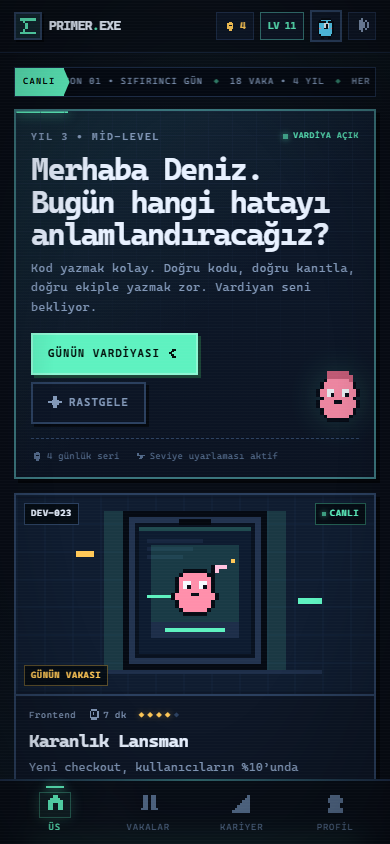
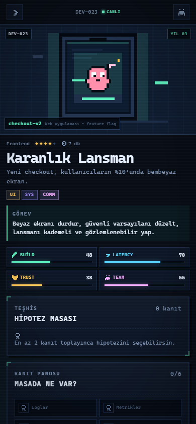
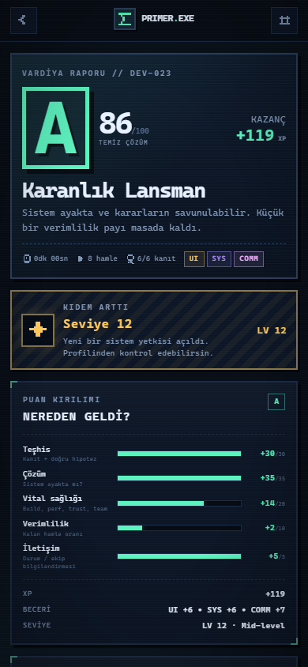
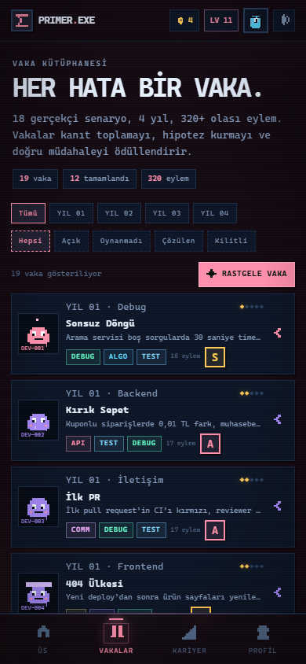
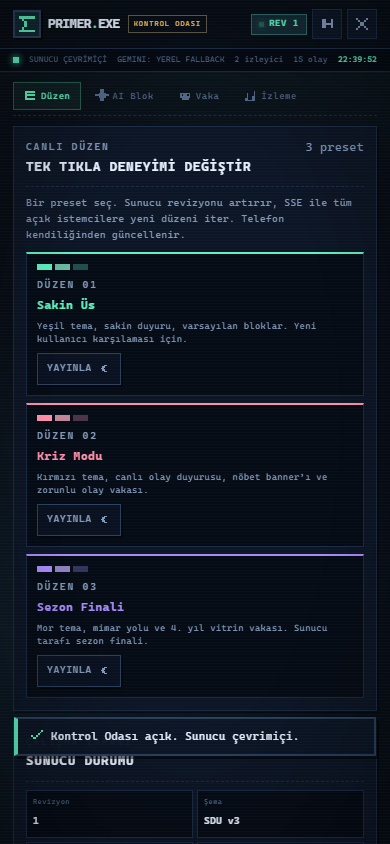
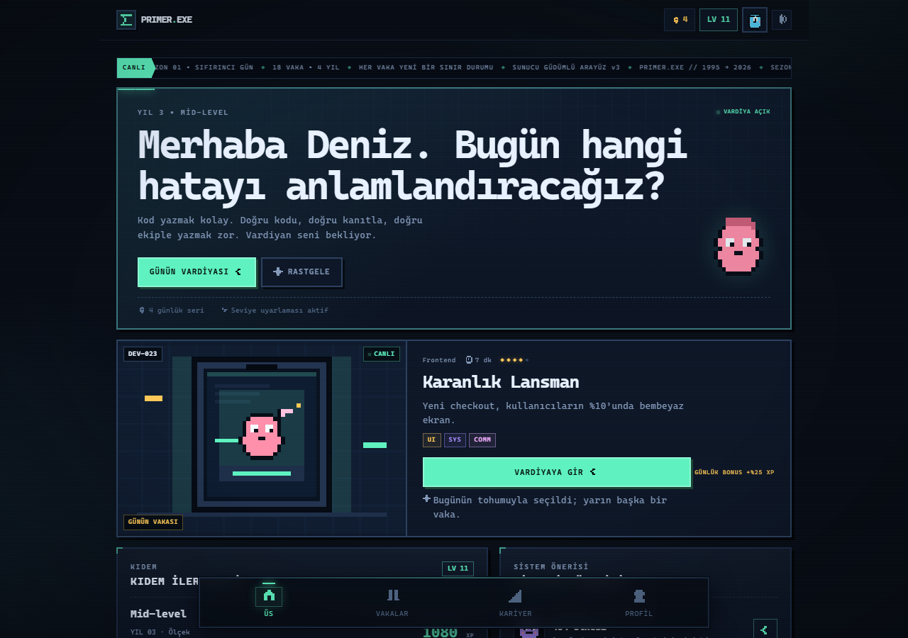

# PRIMER.EXE — Genç Mühendisin Resimli Kılavuzu 🕹️📖
> **"Seninle büyüyen yazılım mühendisliği simülatörü."**  
> *1995'te Neal Stephenson'ın romanında (The Diamond Age) hayal edilen ve kızıyla birlikte büyüyen "Primer" fikrinin, modern yapay zekâ ve web teknolojileriyle hayata geçirilmiş hâli.*

---

## 📌 Ödev Künyesi ve Bağlam

- **Ders / Görev:** Ödev 5: Seninle büyüyen oyun — yazılım mühendisliğine hazırlayan canlı mobil uygulama
- **Öğretim Üyesi:** Prof. Dr. Nurettin Şenyer
- **Geliştirici:** Enes Gadiş ([@enesgadis](https://github.com/enesgadis))
- **Canlı Kod / Depo:** [github.com/enesgadis/oyun](https://github.com/enesgadis/oyun.git)

---

## 🎯 Projenin Amacı ve Felsefesi

Bu proje; bir yazılım mühendisi adayını üniversiteye adım attığı **1. Günden (Sıfırıncı Gün)**, mezuniyet ve sektörde **Lead/Mimar** seviyesine kadar uzanan 4 yıllık serüveninde hayata hazırlayan, **kullanıcıyla birlikte büyüyen**, **dış dünyadaki gelişmelerle güncellenen** ve **sunucu güdümlü arayüz (Backend-Driven UI)** mimarisiyle çalışan canlı bir mobil simülasyon oyunudur.

Oyunlaştırma burada yüzeysel bir puan/rozet süsü değil; öğrenmenin, hata yapmanın ve bedel ödemenin bizzat kendisidir.

---

## 🌟 Ödev Gereksinimlerinin Karşılanması

### 1. Oyun Gibi Görünmeli (Oyunlaştırma = Öğrenmenin Kendisi)
- **Retro-Cyberpunk & Terminal Estetiği:** CRT tarama çizgileri, dinamik ses sentezleyicisi (Web Audio API ile 8-bit SFX), retro pikselli avatarlar ve terminal teması.
- **Gerçekçi Saha Krizleri (18 İnteraktif Vaka):** Kullanıcı sadece soru çözmez; canlıya çıkmış bozuk bir servisi kurtarır, bellek sızıntısını profiler ile yakalar, SQL kilitlenmelerini çözer ya da yapay zekâ halüsinasyonlarını filtreler.
- **Vaka Döngüsü:** 
  1. *Triyaj (Triage):* Sistemin hayati değerleri (CPU, Gecikme, Hata Payı, Güven) düşerken logları, metrikleri ve PR diff'lerini inceleme.
  2. *Hipotez Üretme:* Kanıtlara dayanarak hipotez kurma ve test etme.
  3. *Onarım & Bedel:* Yanlış aksiyonların hayati metrikleri tüketmesi; doğru onarımla SLA'i kurtarma.
  4. *Debrief (Otopsi / Post-Mortem):* Not alma, kök neden analizi ve S/A/B/C/F karne derecelendirmesi.

### 2. Kullanıcıyla Birlikte Büyümeli (4 Yıllık Mühendislik Eğrisi)
Uygulama kullanıcının seviyesine ve kariyer yılına göre evrilir:
- **YIL 01 — Sıfırıncı Gün (Junior Intern):** Terminal temelleri, Git çakışmaları, null pointer istisnaları, basit HTTP API mantığı.
- **YIL 02 — İlk Teslimat (Junior Dev):** N+1 sorgu problemleri, CSS layout patlamaları, bellek sızıntıları, veri yarışı (race condition).
- **YIL 03 — Ölçek & Dayanıklılık (Mid-Level):** Dağıtık sistem kilitlenmeleri, Redis önbellek çöküşü (cache avalanche), JWT güvenlik açıkları, idempotency ihlalleri.
- **YIL 04 — Mimar & Karar Verici (Senior / Lead):** Eventual consistency ikilemleri, LLM ajan döngüleri, veri göçü (zero-downtime migration), çoklu bölge (multi-region) yük dengeleme.

### 3. Dış Dünyayla Birlikte Güncellenmeli (Canlı Dünya / Sektör Entegrasyonu)
- **Canlı Sektör Vakaları:** 2026 dünyasındaki güncel yazılım krizleri (ör. AI Agent prompt injection, vektör veritabanı ölçekleme sorunları, eBPF izleme).
- **Canlı Güncelleme Akışı (SSE & Dynamic Patches):** Sunucuda tanımlanan yeni vakalar, duyurular veya krizler anında istemciye yansıtılır.
- **Günün Vakası (Daily Case):** Her gün yenilenen, istikrarlı deterministik günlük görevler.

### 4. Bir Kez Yüklenmeli, Tekrar Tekrar Yüklenmemeli (Backend-Driven UI / PWA)
- **Tek Yükleme — PWA (Progressive Web App):** Telefona ana ekrana eklendiğinde tam ekran native mobil uygulama gibi çalışır, offline desteği sunar (Service Worker).
- **Sunucu Güdümlü Arayüz (SDUI):** İstemci yalnızca bir render motorudur. Ekran blokları, kart dizilimleri, rozetler ve vaka şemaları sunucunun `/api/bootstrap` ve `/api/events` uçlarından dinamik olarak gelir. Uygulama marketten tekrar güncelleme almadan tüm deneyim sunucudan mutasyona uğrayabilir.

### 5. Google Ekosistemi & Kullanılan Araçlar
- **Google Antigravity & Gemini:** Oyunun vaka üretiminde, şema doğrulamasında ve pedagojik senaryoların kurgulanmasında Gemini modelleri ve Google Antigravity asistanı merkezde yer almıştır.
- **AI Studio & Playground:** Gerçekçi vaka metinleri, kriz senaryoları ve sistem loglarının üretiminde prompt engineering ve doğrulama amacıyla kullanılmıştır.
- **Web Audio API & Vanilla ES Modules:** Sıfır dış bağımlılık (zero external dependency) ile çalışan, hafif, son derece hızlı ve her platformda (iOS Safari, Android Chrome vb.) tam uyumlu saf mimari.

---

## 🧠 Derste Vurgulanan Üç İnsan İşi

### 1. Spesifikasyon (Açık ve İki Ucu Bağlı Tasarım)
- Ajanların ve geliştiricinin kör noktada kalmaması için tüm vaka ve oyun mantığı katı kurallarla şemalandırılmıştır (`shared/schema.mjs`).
- Her vaka: Hayati değerler (vitals), 6 evrensel kanıt yuvası (Log, Metrik, Kod, Ağ, Diff, Ekip), minimum 2 hipotez, riskli eylemler ve onarım gereksinimleri ile formalize edilmiştir.

### 2. Değerlendirme (Eval & Test Kültürü)
Projede *"Çalışıyor mu?"* sorusu hislerle değil, somut metriklerle yanıtlanır:
- **Birim Testleri (`npm test`):** 27/27 geçen test senaryosu (şema geçerliliği, SDUI kontratı, puanlama algoritması, ipucu mekaniği, can kaybı).
- **İçerik Değerlendirmesi (`npm run eval`):** Pedagojik dengeyi ölçen 15 kriterli otomatik eval motoru:
  - 18 vaka / 305 olası karar eylemi / 108 kanıt noktası.
  - 4 yıla dengeli dağılmış zorluk skalası (1.75'ten 4.6'ya).
  - 7 temel yetenek alanı (Debug, Algo, Sistem, Frontend, Backend, Test, İletişim).
  - Puan: **100 / 100 PASS**.

### 3. Ürün Kararı (Neyi İnşa Ettik, Neyi Dışarıda Bıraktık?)
- **İnşa Edilen:**
  - Derin, dallanan ve yanlış kararların bedel ürettiği interaktif simülasyon.
  - Sıfır paket yükü (zero dependency) — Node.js yerleşik modülleri ile çalışan taş gibi sağlam sunucu (`server.mjs`).
  - Telefonun cebinde taşıyabileceği tam uyumlu PWA mobil deneyimi.
- **Bilinçli Olarak Dışarıda Bırakılanlar:**
  - Hantal framework'ler (React/Angular/Vue build karmaşası): Hızlı yükleme, mobil tarayıcı hafifliği ve SDUI sadeliği için saf modern JS/CSS seçildi.
  - Basit çoktan seçmeli ezber quiz formatı: Gerçek mühendislik şık işaretlemek değil; karmaşık bir sistemde log inceleyip hipotez test etmektir.

---

## 📱 Ekran Görüntüleri

| Mobil Ana Sayfa | Vaka Ekranı (Mobil) | Rapor & Analiz |
|:---:|:---:|:---:|
|  |  |  |

| Kütüphane / Vakalar | Konsol & Yönetim | Masaüstü Görünümü |
|:---:|:---:|:---:|
|  |  |  |

---

## 🚀 Kurulum ve Çalıştırma

Projeyi yerelinizde veya telefonunuzda test etmek için:

### 1. Gereksinimler
- Node.js (v20 veya üzeri)

### 2. Başlatma
```bash
# Depoyu klonlayın
git clone https://github.com/enesgadis/oyun.git
cd oyun

# Sunucuyu başlatın (Hiçbir npm install gerektirmez!)
npm start
```

Sunucu varsayılan olarak `http://localhost:1995` portunda çalışacaktır.

### 3. Telefonda Canlı Çalıştırma
Aynı Wi-Fi ağındayken terminalde yazan yerel IP adresiyle (örneğin `http://192.168.1.XX:1995`) telefonunuzun tarayıcısından (Chrome veya Safari) giriş yapın.
- **Android:** *Menü > Ana Ekrana Ekle*
- **iOS:** *Paylaş > Ana Ekrana Ekle*

Uygulama tam ekran, çevrimdışı destekli bir PWA olarak telefonunuza kurulacaktır.

---

## 🧪 Test ve Doğrulama Komutları

```bash
# Şema ve motor birim testlerini çalıştırır (27 test)
npm test

# Müfredat ve içerik pedagoji değerlendirmesini çalıştırır
npm run eval
```

---

## 📂 Proje Yapısı

```
├── .data/              # Sunucu çalışma zamanı durumları ve olay akışı
├── css/                # Retro-modern arayüz ve ekran stilleri
├── docs/               # Ekran görüntüleri ve değerlendirme raporları
├── icons/              # PWA mobil simgeleri
├── js/
│   ├── screens/        # SDUI tarafından yönlendirilen modüler ekranlar
│   ├── api.mjs         # Sunucu REST ve SSE haberleşmesi
│   ├── audio.mjs       # Web Audio API 8-bit ses sentezleyici
│   ├── engine.mjs      # Vaka triyaj ve skor hesaplama motoru
│   └── store.mjs       # Yerel durum ve ilerleme yönetimi
├── shared/
│   ├── cases/          # 4 yıla yayılan 18 detaylı kriz vakası
│   ├── content.mjs     # SDUI bootstrap ve vaka derleyicisi
│   ├── meta.mjs        # Rozetler, roller ve yetenek ağaçları
│   └── schema.mjs      # Katı doğrulama şemaları
├── tests/              # node:test tabanlı motor ve şema testleri
├── index.html          # Mobil öncelikli PWA kabuğu
├── manifest.webmanifest# PWA manifestosu
├── server.mjs          # Sıfır bağımlılıklı Node.js HTTP/SSE sunucusu
└── sw.js               # Service Worker (Offline önbellek)
```

---
*2026 — Bilgisayar Mühendisliği Bölümü için sevgi, özen ve gerçek mühendislik disipliniyle geliştirilmiştir.*
